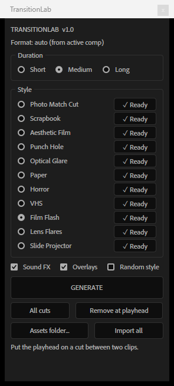

# TransitionLab



**Процедурные переходы для After Effects и EffectCraft: каждый раз новые.** Поставьте плейхед на склейку, нажмите **GENERATE**, и скрипт соберёт переход из встроенных эффектов AE. Плагины и готовые паки не нужны. Каждый запуск берёт новый сид, поэтому варианты, палитры, траектории и тайминги всегда разные.

Бесплатно, открытый код (MIT). Автор: Yurii Ermyakov.

> Независимый проект, не связан с Adobe и ArtCraft. After Effects и EffectCraft — товарные знаки их владельцев.

[English below](#english)

## Установка
1. Скачайте `TransitionLab-x.y.z.zip` из [Releases](../../releases/latest) и распакуйте.
2. **Быстро:** File → Scripts → Run Script File… → `TransitionLab.jsx` (папка `assets` должна лежать рядом).
3. **Докируемая панель:** скопируйте `TransitionLab.jsx` и папку `assets` в
   `C:\Program Files\Adobe\Adobe After Effects <версия>\Support Files\Scripts\ScriptUI Panels\`
   (нужны права администратора), перезапустите AE → Window → TransitionLab.jsx.
   Если панель не нашла ассеты, нажмите **Assets folder…** и укажите папку `assets`.

## EffectCraft

[EffectCraft](https://getartcraft.com/apps/effectcraft) — бесплатный композитор с открытым кодом, похожий на After Effects.
Для него есть отдельная сборка, AE-версию она не затрагивает.

1. Скачайте `TransitionLab-EffectCraft-x.y.z.zip` из [Releases](../../releases/latest) и распакуйте.
2. Запустите `install.ps1` (правый клик > «Выполнить с помощью PowerShell» или
   `powershell -ExecutionPolicy Bypass -File install.ps1`). Он ставит панель и звуки в
   `%APPDATA%\EffectCraft\Scripts\ScriptUI Panels\TransitionLab\`.
3. Перезапустите EffectCraft: *Window > TransitionLab > TransitionLab.jsx*.

Работает так же: 11 стилей, Generate, All cuts, Remove at playhead, звуки. Внутри EffectCraft нумерует параметры
эффектов иначе, чем After Effects, поэтому `effectcraft/TransitionLab-EC.jsx` собирается из основного скрипта командой
`node tools/build_ec.mjs` с переводом номеров; отличается и внешний вид шума Fractal Noise, так что огонь в Film Flash
выглядит чуть иначе. Свои оверлеи и звуки EffectCraft увидит, только если включить
*Preferences > Scripting & Expressions > Allow Scripts to Write Files and Access Network*; встроенные работают без этого.

## Как пользоваться
1. Формат определяется сам по композиции (16:9 / 9:16 / 1:1).
2. **Duration**: Short / Medium / Long, относительный темп перехода.
3. Выберите стиль или поставьте галочку **Random style**.
4. Поставьте плейхед на склейку двух клипов и нажмите **GENERATE**. Скрипт сам находит ближайшую склейку в пределах ±1 с.

Ещё:
- **All cuts**: переход на каждой склейке композиции.
- **Remove at playhead**: удаляет переход под плейхедом целиком.
- **Import**: импортирует SFX и ваши оверлеи стиля в бин `TransitionLab/<стиль>` (Generate делает это сам, если забыли).
- Ctrl+Z отменяет генерацию одним шагом.

Слои перехода называются `CA07 Film Flash | …`, у них один цвет метки, а в комментарии записано `TL:<номер>:<стиль>:<сид>`.

## 11 стилей
| Стиль | Что делает |
|---|---|
| Photo Match Cut | кадр A становится фотографией, сверху падает фото B (полароид, стопка снимков), вспышка, B раскрывается в кадр |
| Scrapbook | стоп-моушн коллаж 8–12 fps: вырезки из A и B, рваные края, скотч, цветные обрывки |
| Aesthetic Film | прокрутка плёнки с перфорацией, тёплый тон, зерно, засветка |
| Punch Hole | царапины, пыль, cue-метка, прыжок кадра, кадр A прожигается дырами до B |
| Optical Glare | цветные пятна света, анаморфные полосы, bloom |
| Paper | лист (стопка или разрыв пополам) пролетает с рваными краями и тенью |
| Horror | тряска, чёрные и инвертированные кадры, хроматика, статический шум |
| VHS | срыв кадра, горизонтальные разрывы, трекинг-шум, сканлайны, OSD «PLAY ►» |
| Film Flash | огненный прожиг, засветка, белый кадр, тряска |
| Lens Flares | 1–2 блика пролетают через кадр, анаморфная полоса, whiteout |
| Slide Projector | слайд уезжает, новый въезжает с перефокусом, дрожанием и виньеткой |

## Свои ассеты
- `assets/<Стиль>/sfx/*.wav`: удар (точка склейки) должен быть ровно на **0,5 с**.
- `assets/<Стиль>/overlays/*.mov|mp4|png`: с вероятностью 60% кладётся по центру склейки в режиме Screen.

Встроенные звуки сгенерированы процедурно, без сэмплов: `node tools/make_sfx.mjs` (по 4 варианта на стиль).

## Сторонние плагины

Если установлены CS Vignette или Mettle SkyBox Chromatic Aberration, Horror и Slide Projector используют их.
Без них (с версии 1.0.1) виньетка делается обычным чёрным солидом с маской, а хроматика пропускается.

## Для автоматизации
```js
$.global.TL_HEADLESS = true; $.evalFile(File("<path>/TransitionLab.jsx"));
TL.generate({ style: "VHS", duration: "medium", seed: 123 });   // style: id или "random"
TL.generateAll({ style: "random" });  TL.removeAt();
```
`test/run_batch.jsx` и `test/sheet.sh` делают контактные листы кадров вокруг склейки для каждого стиля (нужна своя тестовая композиция `TL test` с двумя клипами).

---

## English

**TransitionLab** is a free, open-source After Effects script that builds procedural transitions at the cut under the playhead. It uses only native AE effects, with no third-party plugins or stock packs. Every run picks a new seed, so no two transitions are the same.

**Install:** download the zip from [Releases](../../releases/latest), then either run `TransitionLab.jsx` via File → Scripts → Run Script File (keep the `assets` folder next to it), or copy the script and `assets` into `Support Files/Scripts/ScriptUI Panels/` and open Window → TransitionLab.jsx.

**Use:** put the playhead on a cut, pick a style (or Random) and a duration, press **GENERATE**. **All cuts** fills every cut in the comp; **Remove at playhead** deletes a transition; Ctrl+Z undoes a generation in one step. Aspect ratio (16:9, 9:16, 1:1) is detected automatically.

**11 styles:** Photo Match Cut, Scrapbook, Aesthetic Film, Punch Hole, Optical Glare, Paper, Horror, VHS, Film Flash, Lens Flares, Slide Projector.

**Custom assets:** put WAVs with the hit at exactly 0.5 s in `assets/<Style>/sfx/` and overlays in `assets/<Style>/overlays/`. Built-in SFX are synthesized procedurally (`node tools/make_sfx.mjs`).

**EffectCraft:** a separate build for [EffectCraft](https://getartcraft.com/apps/effectcraft), the free open-source compositor. Download `TransitionLab-EffectCraft-x.y.z.zip`, run `install.ps1`, restart EffectCraft and open *Window > TransitionLab > TransitionLab.jsx*. Same 11 styles; the After Effects version is not affected.

Not affiliated with Adobe or ArtCraft. License: MIT.
